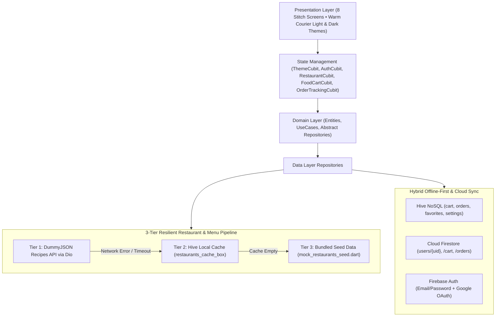

# Cravee — Flutter Food Delivery Application (Task 6 — Advanced Capstone)

[](https://flutter.dev)
[](https://dart.dev)
[-1E88E5)](https://bloclibrary.dev)
[](https://blog.cleancoder.com/uncle-bob/2012/08/13/the-clean-architecture.html)
[](https://firebase.google.com)
[](https://docs.hivedb.dev)
[](#testing--quality-verification)
[](#testing--quality-verification)

An enterprise-grade, cross-platform **Food Delivery Mobile Application** built with **Flutter**, **Clean Architecture**, and **Cubit (`flutter_bloc`)** as the **Task 6 (Advanced) Capstone Project** for the **Auspify Technologies 4-Week Practical Learning Internship Program**.

Designed with the **Warm Courier** Design System (`Plus Jakarta Sans`, `#FF4B26` primary, `#10B981` secondary, `#F59E0B` tertiary) across **8 cohesive screens** supporting full **Light Mode & Dark Mode**, the app delivers an end-to-end food ordering experience powered by **Firebase Authentication**, **Cloud Firestore**, **Hive NoSQL**, and a **3-tier zero-deadlock restaurant & menu catalog pipeline**.

---

## Key Features

### 1. Authentication & Cloud Profile Sync (`AuthCubit`)
- **Email & Password** Sign-In and Sign-Up with inline form validation and user-friendly error mapping.
- **One-Tap Google Sign-In** (`google_sign_in` + `firebase_auth`).
- Automatic `users/{uid}` profile creation/merging in **Cloud Firestore** with session persistence across launches.

### 2. 3-Tier Resilient Restaurant & Menu Pipeline (`RestaurantCubit`)
- **Tier 1 — Live REST API:** Fetches recipes from `https://dummyjson.com/recipes` via `dio` and deterministically groups dishes by cuisine/meal type into curated multi-category restaurant storefronts.
- **Tier 2 — Hive Offline Cache:** Automatically caches live storefronts in `restaurants_cache_box` for instant offline browsing.
- **Tier 3 — Bundled Seed Fallback:** Includes a curated 6-restaurant offline seed catalog (`mock_restaurants_seed.dart`) guaranteeing **zero deadlocks** even on a completely offline first launch.
- Multi-criteria discovery: Cuisine pills (`All`, `Burgers`, `Pizza`, `Asian`, `Italian`, `Healthy`, `Desserts`), live search across restaurants & dishes, `< 30 Mins`, `4.5+ ★`, `Free / Low Delivery`, sorting (`Popular`, `Fastest Delivery`, `Lowest Delivery Fee`, `Top Rated`), and optimistic favorite restaurant toggling synced across Hive & Firestore.

### 3. Meal Customization & Single-Restaurant Hybrid Cart (`FoodCartCubit`)
- **Meal Customization:** Mandatory portion size radio cards (`Small (Regular)`, `Medium +$2.00`, `Large +$4.00`), optional multi-select extra add-ons (`Extra Cheese`, `Crispy Smoked Beef`, `Signature Sauce`, `Soft Drink Combo`), kitchen notes (200-char limit), quantity stepper, and live price calculation.
- **Single-Restaurant Cart Rule:** Detects cross-restaurant additions and prompts the user cleanly via `CartConflictDialog` (`Keep Current` vs `Start New Cart`) before clearing the active basket.
- **Promo Code Engine:** Live discount evaluation for `WELCOME20` (**20% off subtotal**) and `FREEDEL` (**Free Delivery**).
- **Hybrid Persistence:** Instant reads/writes in Hive `food_cart_box` paired with Cloud Firestore batch synchronization (`users/{uid}/cart/{cartItemId}`).

### 4. Simulated Checkout, Live 4-Stage Order Tracking & One-Tap Reorder (`OrderTrackingCubit`)
- **Checkout:** Editable delivery address form, `Credit / Debit Card` (simulated Visa `•••• 4242`) vs `Cash on Delivery` selector, and itemized bill summary.
- **Interactive Live Order Tracking:** Stylized `CustomPainter` curved route header with animated courier scooter pin & live ETA badge, 4-stage animated timeline stepper (`Order Confirmed` → `Preparing in Kitchen` → `Out for Delivery` → `Delivered`), simulated courier card with Call/Message feedback, and an interactive **"Simulate Next Stage"** button updating both **Hive** and **Cloud Firestore** live.
- **Profile & One-Tap Reorder:** Saved Favorite Restaurants carousel, complete Order History with live status badges, persistent Light/Dark `ThemeCubit` switch, and **One-Tap Reorder** re-hydrating the cart instantaneously.

---

## System Architecture



---

## 8 Core Screens (Warm Courier UI)

| # | Screen | File | Highlights |
| :-: | :--- | :--- | :--- |
| **1** | **Authentication** | `lib/presentation/pages/auth/login_page.dart` & `register_page.dart` | Segmented Sign In / Sign Up switcher, Email/Password validation, Google Sign-In, Light/Dark toggle |
| **2** | **Home & Discovery** | `lib/presentation/pages/home/home_discovery_page.dart` & `shell/main_shell_page.dart` | Delivery location bottom sheet, active order floating banner, promo hero card, cuisine pills, Fastest Near You carousel, floating pill 4-tab dock |
| **3** | **Search & Filters** | `lib/presentation/pages/search/restaurant_search_page.dart` | Live search across restaurants & dishes, multi-filter chips, sort sheet, Restaurants vs Dishes segmented tabs |
| **4** | **Restaurant Storefront** | `lib/presentation/pages/restaurant/restaurant_details_page.dart` | Hero cover with frosted actions, overlapping info card, sticky category tabs, sticky bottom "View Cart" bar |
| **5** | **Meal Customization** | `lib/presentation/pages/customization/meal_customization_page.dart` | Mandatory sizes, multi-select add-ons, kitchen notes, Single-Restaurant conflict dialog, live total CTA |
| **6** | **Cart & Checkout** | `lib/presentation/pages/cart/food_cart_checkout_page.dart` | Swipe-to-delete customized items, `WELCOME20` / `FREEDEL` promos, delivery address form, COD vs Card UI, bill summary |
| **7** | **Live Order Tracking** | `lib/presentation/pages/tracking/live_order_tracking_page.dart` | Curved route & animated scooter marker, 4-stage timeline stepper, courier card, "Simulate Next Stage" button |
| **8** | **Profile & History** | `lib/presentation/pages/profile/user_profile_page.dart` | Firebase user hero stats, Saved Favorite Restaurants strip, Past Orders with Track Live & One-Tap Reorder, Theme switch, Sign Out |

---

## Cloud Firestore Schema & Security Rules

Owner-scoped Cloud Firestore Security Rules are defined and validated in [`firestore.rules`](firestore.rules) with default-deny fallback:

- **`users/{uid}`** *(owner read/create/update; delete denied)*  
  `uid`, `name`, `email`, `photoUrl`, `defaultAddress` (`fullName`, `phone`, `street`, `city`), `favoriteRestaurantIds`, `createdAt`, `updatedAt`.
- **`users/{uid}/cart/{cartItemId}`** *(owner CRUD)*  
  `cartItemId`, `restaurantId`, `restaurantName`, `dishId`, `dishName`, `dishImage`, `basePrice`, `selectedSize`, `selectedAddons`, `specialInstructions`, `quantity` (`1..99`), `unitTotalPrice`, `updatedAt`.
- **`users/{uid}/orders/{orderId}`** *(owner read/create/update; delete denied)*  
  `orderId`, `restaurantId`, `restaurantName`, `items`, `subtotal`, `deliveryFee`, `discountAmount`, `totalPrice`, `paymentMethod`, `deliveryAddress`, `status`, `estimatedMinutesRemaining`, `courierName`, `createdAt`, `updatedAt`.  
  Updates are strictly constrained to monotonic forward status transitions (`confirmed` → `preparing` → `out_for_delivery` → `delivered`) modifying only `status`, `estimatedMinutesRemaining`, and `updatedAt` while keeping all financial and order item fields immutable.

---

## Project Structure

```text
lib/
├── core/
│   ├── constants/app_constants.dart
│   ├── errors/{exceptions.dart, failures.dart}
│   ├── network/dio_client.dart
│   └── theme/{app_colors.dart, app_theme.dart}
├── domain/
│   ├── entities/{app_user_entity.dart, restaurant_dish_entities.dart, cart_order_entities.dart}
│   ├── repositories/{auth_repository.dart, restaurant_repository.dart, food_cart_order_repository.dart}
│   └── usecases/{auth_usecases.dart, restaurant_usecases.dart, food_cart_usecases.dart, order_tracking_usecases.dart}
├── data/
│   ├── datasources/
│   │   ├── auth_remote_datasource.dart
│   │   ├── mock_restaurants_seed.dart
│   │   ├── restaurant_remote_datasource.dart
│   │   ├── restaurant_local_datasource.dart
│   │   ├── food_cart_order_local_datasource.dart
│   │   └── food_cart_order_remote_datasource.dart
│   ├── models/{app_user_model.dart, restaurant_dish_models.dart, cart_order_models.dart}
│   └── repositories/{auth_repository_impl.dart, restaurant_repository_impl.dart, food_cart_order_repository_impl.dart}
├── presentation/
│   ├── cubits/{theme/, auth/, restaurant/, cart/, order/}
│   ├── pages/{auth/, shell/, home/, search/, restaurant/, customization/, cart/, tracking/, profile/}
│   └── widgets/
├── firebase_options.dart
├── injection_container.dart
└── main.dart
```

---

## Getting Started

### Prerequisites
- Flutter SDK (3.x) & Dart 3.x
- Firebase project configured with **Email/Password**, **Google Sign-In** (with Android debug SHA-1/SHA-256), and **Cloud Firestore**

### Installation & Run
```bash
# 1. Clone the repository
git clone https://github.com/eslam4546/auspify_food_delivery_app.git
cd auspify_food_delivery_app

# 2. Install dependencies
flutter pub get

# 3. (Optional) Re-bind to your own Firebase project
flutterfire configure

# 4. Deploy Firestore Security Rules
firebase deploy --only firestore:rules

# 5. Launch on an emulator or physical device
flutter run
```

### Interactive Demo Tips
- **Promo Codes:** Try `WELCOME20` (20% off subtotal) or `FREEDEL` (free delivery) on the Cart & Checkout screen.
- **Single-Restaurant Guard:** Add a dish from one restaurant, then try adding a dish from another to trigger the conflict dialog.
- **Live Order Tracking:** After placing an order, tap **"Simulate Next Stage"** on the Live Order Tracking screen to watch the route marker, ETA pill, 4-stage stepper, Hive cache, and Cloud Firestore document update in real time.
- **One-Tap Reorder:** Open the **Profile** tab and tap **Reorder** on any past order to repopulate your active cart immediately.

---

## Testing & Quality Verification

```bash
# Run unit, Cubit (bloc_test + mocktail), and widget tests
flutter test

# Run static analysis
flutter analyze

# Verify code formatting
dart format --output=none --set-exit-if-changed lib test
```

| Verification Check | Status |
| :--- | :--- |
| `flutter test` (`AuthCubit`, `RestaurantCubit`, `FoodCartCubit`, `OrderTrackingCubit`, `OrderStageTimelineStepper`, Seed Integrity) | **13 / 13 Passed** |
| `flutter analyze` | **0 Issues** |
| `dart format lib test` | **60 Files Formatted** |
| `firebase deploy --only firestore:rules` | **Compiled & Deployed** |

---

## Tech Stack

- **Framework:** Flutter (Material 3), Dart 3
- **State Management:** `flutter_bloc` (Cubit), `equatable`
- **Authentication & Cloud Database:** `firebase_core`, `firebase_auth`, `google_sign_in`, `cloud_firestore`
- **Networking:** `dio` (`https://dummyjson.com/recipes`)
- **Offline Storage:** `hive`, `hive_flutter`
- **UI & Utilities:** `cached_network_image`, `shimmer`, `google_fonts`, `intl`, `uuid`
- **Testing:** `flutter_test`, `bloc_test`, `mocktail`

---

*Built with Clean Architecture & Cubit for the **Auspify Technologies Flutter Internship Program**.*
